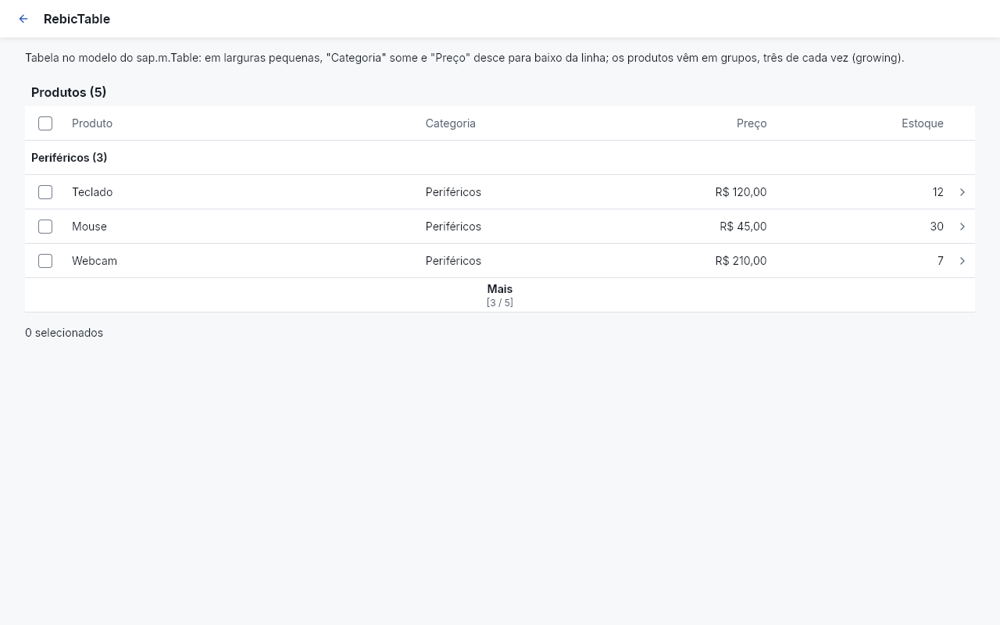
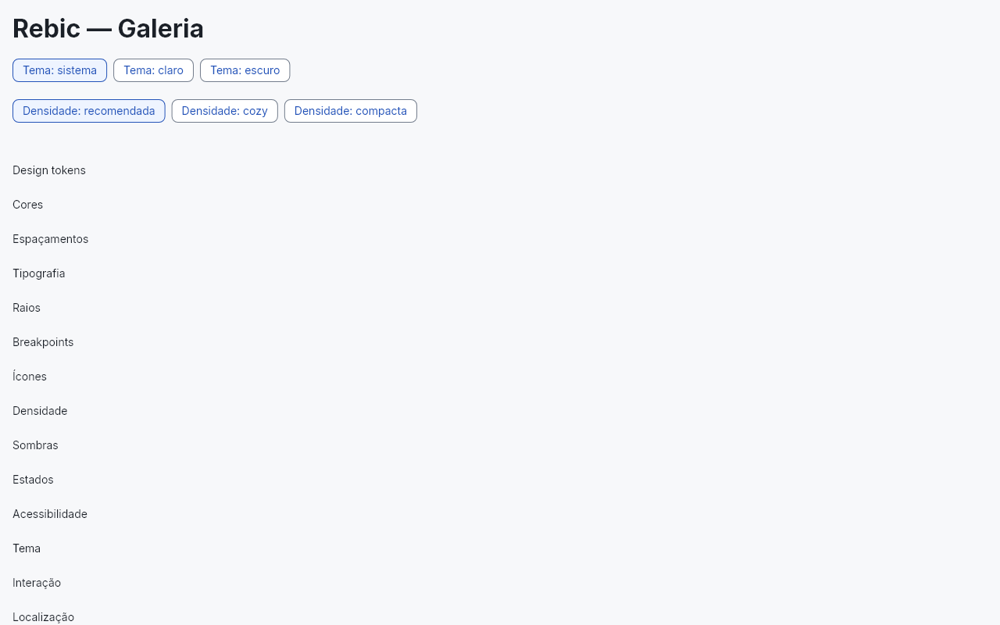
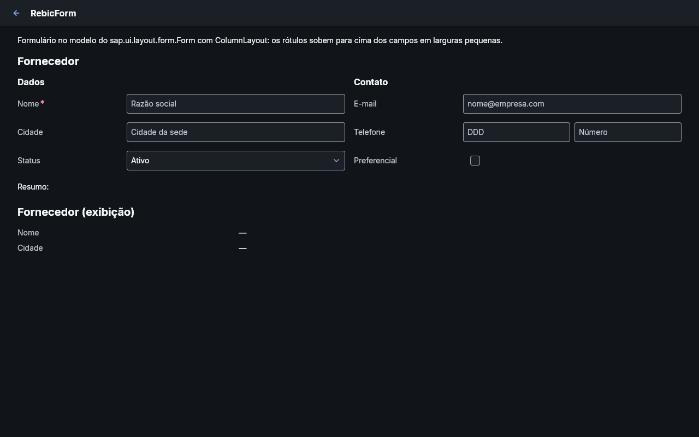
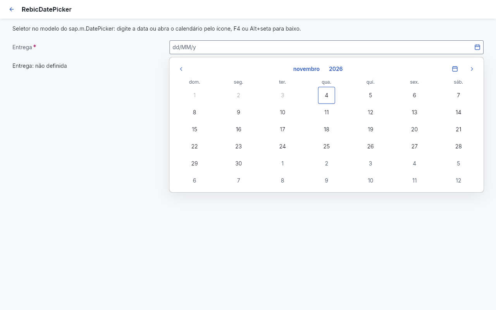
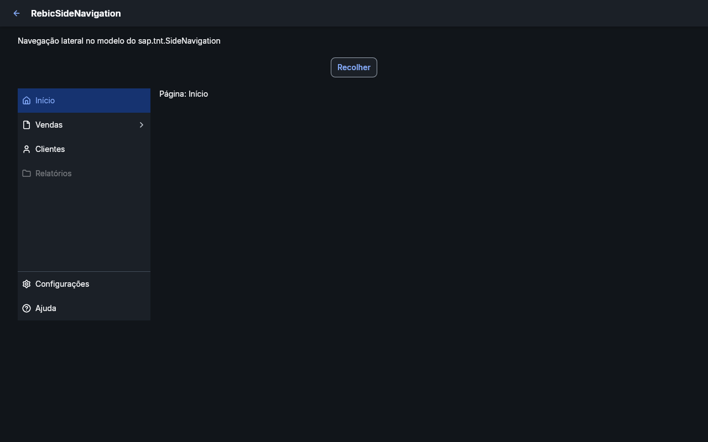
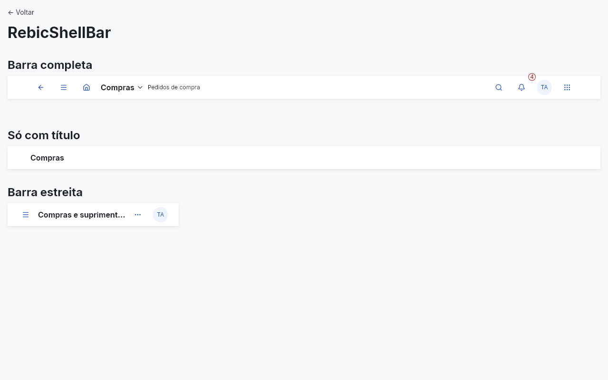

# GJA

GJA é um design system para Flutter que segue o **SAPUI5 / SAP Fiori (tema Horizon)**: os mesmos controles, nomes
de propriedades e eventos, densidades cozy e compacta, temas claro e escuro, sem depender do Material nem do
Cupertino. É um **protótipo**: a base e os componentes estão prontos e testados, e algumas escolhas visuais ainda são
provisórias (veja [Decisões provisórias](#decisões-provisórias)).



## Componentes

Cada componente tem o nome e a API do controle SAPUI5 em que se baseia (por exemplo, `onPress`, `selectedKey`,
`enabled`), e a documentação de cada um cita o controle de referência.

| Fase | Pedido | Widget GJA | Controle SAPUI5 |
|---|---|---|---|
| 1. Fundação | Tokens, cores, tipografia, temas, espaçamento, ícones | `gja_foundation` | tema Horizon, `sap.ui.core.IconPool` |
| 2. Básicos | Button | `GjaButton` | `sap.m.Button` |
| | TextField | `GjaInput` | `sap.m.Input` |
| | Select | `GjaSelect` | `sap.m.Select` |
| | Checkbox | `GjaCheckBox` | `sap.m.CheckBox` |
| | Radio | `GjaRadioButton`, `GjaRadioButtonGroup` | `sap.m.RadioButton(Group)` |
| | Switch | `GjaSwitch` | `sap.m.Switch` |
| | Card | `GjaCard`, `GjaCardHeader` | `sap.f.Card` |
| 3. Feedback | Dialog | `GjaDialog` | `sap.m.Dialog` |
| | Toast | `GjaMessageToast` | `sap.m.MessageToast` |
| | MessageStrip | `GjaMessageStrip` | `sap.m.MessageStrip` |
| | Tooltip | `GjaTooltip` | `tooltip` dos controles |
| | Loading | `GjaBusyIndicator` | `sap.m.BusyIndicator` |
| | EmptyState | `GjaIllustratedMessage` | `sap.m.IllustratedMessage` |
| 4. Navegação | ShellBar | `GjaShellBar` | `sap.f.ShellBar` |
| | SideNavigation | `GjaSideNavigation` | `sap.tnt.SideNavigation` |
| | Tabs | `GjaIconTabBar` | `sap.m.IconTabBar` |
| | Breadcrumbs | `GjaBreadcrumbs` | `sap.m.Breadcrumbs` |
| | Toolbar | `GjaToolbar` | `sap.m.Toolbar` |
| 5. Dados | Table | `GjaTable` | `sap.m.Table` |
| | Status | `GjaObjectStatus` | `sap.m.ObjectStatus` |
| | Avatar | `GjaAvatar` | `sap.m.Avatar` |
| | ProgressIndicator | `GjaProgressIndicator` | `sap.m.ProgressIndicator` |
| | DatePicker | `GjaDatePicker` | `sap.m.DatePicker` |
| 6. Layout | Container | `GjaContainer` | `backgroundDesign` dos contêineres |
| | Row / Column | `GjaHBox` / `GjaVBox` | `sap.m.HBox` / `sap.m.VBox` |
| | Accordion | `GjaPanel` (painéis expansíveis empilhados) | `sap.m.Panel` |
| | Form | `GjaForm` | `sap.ui.layout.form.Form` + `ColumnLayout` |
| | ResponsiveLayout | `GjaResponsiveLayout` (conteúdo por classe de tamanho) e `GjaGrid` | faixas S/M/L/XL de `sap.ui.Device.media` e `sap.ui.layout.Grid` |

Além desses, há `GjaToolPage`, `GjaPage`, `GjaBar`, `GjaPopover`, `GjaMenu`, `GjaDropdown`, `GjaLink`,
`GjaLabel`, `GjaTitle`, `GjaText`, `GjaBadge`, `GjaSeparator` e outros. O catálogo completo, com prioridade e
dependências de cada item, está em [`docs/catalog.yaml`](docs/catalog.yaml).

## Arquitetura

O projeto é um workspace Dart com quatro pacotes em camadas; cada camada só depende das de baixo (verificado
automaticamente).

```
gja_ui          ponto de entrada: reexporta tudo
  └─ gja_widgets     os widgets públicos (pastas por categoria)
       └─ gja_core        interação, foco, overlay, localização, responsividade
            └─ gja_foundation  design tokens, tema, densidade, breakpoints, ícones
```

- **Sem Material/Cupertino** na API pública ([ADR 0004](docs/adr/0004-no-material-public-api.md)).
- **Design tokens em três níveis**: primitivos, semânticos e de componente
  ([ADR 0005](docs/adr/0005-design-tokens-three-levels.md)). Nenhum widget usa cor, medida ou duração literal.
- **Widgets controlados**: o estado (valor, seleção, aberto/fechado) vem do pai, e os eventos têm os nomes do UI5
  ([ADR 0006](docs/adr/0006-state-and-data-integration.md)).
- **Acessibilidade** em todos os componentes: contraste, alvo mínimo, teclado, leitor de tela e RTL, todos testados.
- **Localização** em pt-BR (padrão) e en, com datas e números do CLDR.

Uma aplicação usa só o pacote `gja_ui`:

```dart
import 'package:flutter/widgets.dart';
import 'package:gja_ui/gja_ui.dart';

void main() => runApp(
  GjaApp(
    home: GjaPage(
      title: 'Pedidos',
      content: [
        GjaButton(text: 'Novo pedido', type: GjaButtonType.emphasized, onPress: () {}),
      ],
    ),
  ),
);
```

## Como executar

Se o projeto chegou como `gja.bundle` (um repositório Git com todo o histórico):

```bash
git clone gja.bundle gja
cd gja
```

No Windows, alguns caminhos do histórico de specs são longos; se o clone reclamar de "Filename too long", rode antes
`git config --global core.longpaths true` ou clone numa pasta perto da raiz (por exemplo, `C:\gja`).

Requer o **Flutter 3.32.6** (stable), versão fixada em [ADR 0001](docs/adr/0001-sdk-baseline.md).

```bash
flutter pub get

# Galeria no navegador
cd apps/gja_gallery
flutter run -d chrome
```

Também roda como aplicação Windows (`flutter run -d windows`). A galeria tem uma página por fundamento e por
componente, com seletores de tema (claro, escuro, sistema) e de densidade (cozy, compacta).

## Qualidade

```bash
bash tool/ci.sh        # ou: pwsh tool/ci.ps1
```

O pipeline (o mesmo do CI em `.github/workflows/ci.yml`) roda a análise estática, os testes de todos os pacotes, a
validação das specs OpenSpec e as verificações próprias do projeto (`tool/gja_checks`): camadas e imports,
ausência de valores literais, estrutura das specs e coerência do catálogo.

- Cerca de 1.200 testes, com um teste de widget por cenário de cada spec.
- Goldens (imagens de referência) de cada componente em claro/escuro × cozy/compacta, gerados no Windows
  ([ADR 0008](docs/adr/0008-golden-reference-windows.md)): `flutter test --tags golden`.
- As capturas deste README são geradas por
  `flutter test tool/screenshots/screenshots_test.dart --update-goldens` (em `apps/gja_gallery`).

## Especificações (OpenSpec)

Todo componente nasce de uma spec em [`openspec/specs/`](openspec/specs/), com requisitos agrupados por etiqueta
(API, Comportamento, Aparência, Estados, Acessibilidade, Responsividade, Integração, Testes, Documentação e
Restrições), e cada cenário tem um teste com o mesmo nome. Cada mudança passa por proposta, implementação e
arquivamento ([ADR 0007](docs/adr/0007-one-change-per-widget.md)); o histórico fica em
[`openspec/changes/archive/`](openspec/changes/archive/) e nos commits. Como contribuir:
[`docs/CONTRIBUTING.md`](docs/CONTRIBUTING.md).

## Decisões provisórias

- **Fonte Inter** no lugar da SAP 72, e **ícones Lucide** no lugar do SAP-icons, com os nomes do `IconPool`.
- **Alguns valores visuais do Horizon** (tamanhos, espaçamentos e cores de alguns componentes) não foram conferidos
  com o tema oficial; cada um está listado em [ADR 0009](docs/adr/0009-provisional-horizon-values.md).
- **EmptyState** usa ícones do catálogo, não as ilustrações SAP.
- Ficaram fora de propósito, por não serem parte do controle ou dependerem da SAP: validação de formulário, intervalo
  de datas, Joule, campo de pesquisa na barra de shell e cabeçalho fixo da tabela.

## Capturas

| | |
|---|---|
|  |  |
|  |  |
|  |  |
